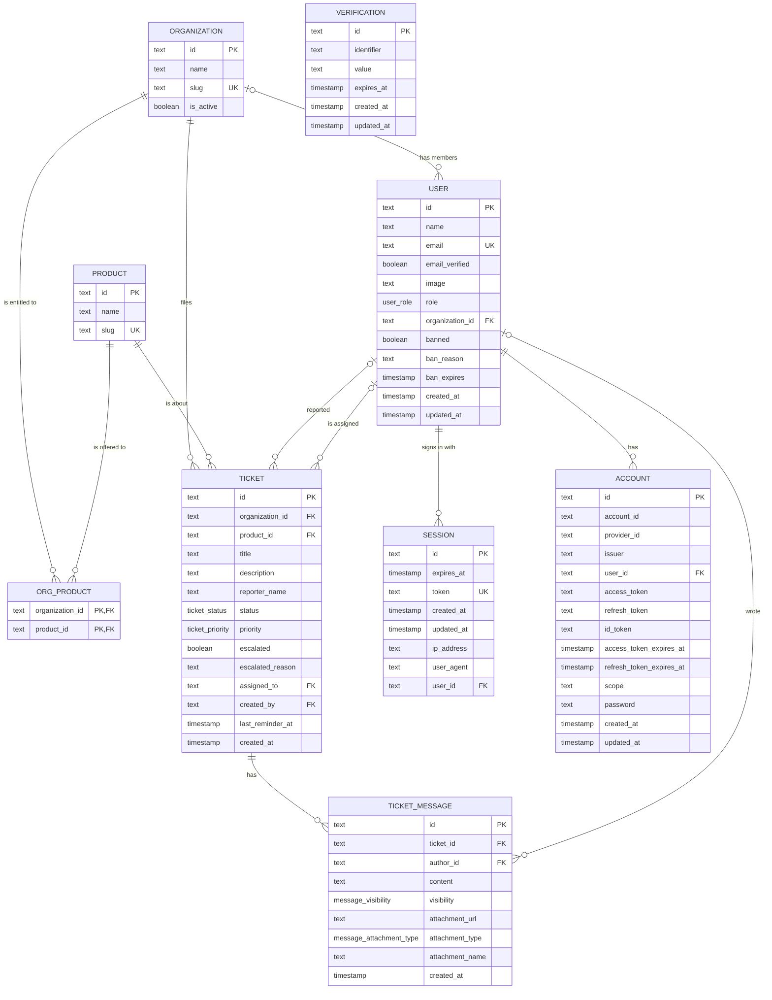

# Ticket System

A support desk for a B2B hardware vendor. Client companies file tickets against the products they bought, technicians work a shared queue, and admins manage companies, product access, and staff accounts. This is a final year project, built as a pnpm workspace with a Cloudflare Worker API and a React web app.

## What it does

Accounts have one of three roles, and the role decides what the API returns and which screens the web app shows.

| Role | Scope | Main work |
| --- | --- | --- |
| `client` | Own organization only | File tickets, follow replies, attach photos or video |
| `technician` | Every client organization | Claim tickets, set status and priority, assign, escalate, reply |
| `admin` | Every client organization plus admin screens | Manage all tickets, companies, entitlements, technicians, and client accounts |

Clients get a dashboard with ticket counts, a searchable and filterable list, an intake form limited to products their company is entitled to, and a ticket page with a message thread. A reply can carry images (4 files, 8 MB each) or one video up to 64 MB, hosted on UploadThing.

Technicians get a queue, a "my work" view, and per-ticket actions: status, priority, assignee, escalation, public reply, or an internal note that clients never see. Their dashboard shows queue counts and the tickets they own. Admins get the full ticket list, an escalated-only view, and a dashboard with status counts, recent activity, and escalated tickets.

Lists poll: tickets every 5 seconds, message threads every 3 seconds. There are no websockets.

Email goes through SendGrid. A new ticket alerts every active technician and admin, assignment mails the new owner, and replies and status changes go to the people involved. Password reset requests start at `/forgot-password`; the mailed link lands on `/reset-password`, where the user sets a new password, and every other session is dropped. New accounts get a verification link that redirects to `/login?verified=1`, and admins can resend it from the client and technician lists. A daily cron at 09:00 UTC nudges open tickets that sat unassigned for a day and in-progress tickets with no reply for three days. Each ticket gets at most one reminder per 24 hours, tracked in `ticket.last_reminder_at`. Without SendGrid credentials the app skips all mail, including reset and verification links, and keeps working.

Deactivating an account deletes its live sessions. Suspending a company deletes the sessions of every member. A sign-in hook and a per-request check in the API keep both out until an admin reverses the change.

## Stack

| Part | Choice |
| --- | --- |
| API | Hono and oRPC on Cloudflare Workers, with zod schemas |
| Database | PostgreSQL on Neon, Drizzle ORM over the neon-http driver |
| Auth | Better Auth with email and password, database sessions, password reset, and email verification |
| Uploads | UploadThing |
| Email | SendGrid v3 HTTP API, plus a daily reminder cron |
| Web | React 19, Vite, TanStack Router, TanStack Query, TanStack Table |
| Styling | Tailwind CSS v4, Base UI, coss ui patterns, IBM Plex |
| State | Zustand for shell and theme state |
| Tooling | pnpm workspace, oxlint, oxfmt, Vitest |

## Database

PostgreSQL holds everything: the Better Auth tables, the vendor catalog, client companies, tickets, and messages. The Worker talks to it through the `neon-http` driver, so `DATABASE_URL` must be a Neon connection string. A plain Postgres over TCP will not work from the Worker.



The enums:

| Enum | Values |
| --- | --- |
| `user_role` | `admin`, `technician`, `client` |
| `ticket_status` | `open`, `in_progress`, `resolved` |
| `ticket_priority` | `low`, `normal`, `high`, `urgent` |
| `message_visibility` | `public`, `internal` |
| `message_attachment_type` | `image`, `video` |

A few constraints the schema relies on:

- Every id is `text` because Better Auth generates user, session, and account ids that way. Ticket, organization, and product ids follow the same shape.
- `org_product` has a composite primary key on `(organization_id, product_id)`, so an entitlement cannot be inserted twice.
- Deleting an organization cascades to its entitlements and tickets, and sets members' `organization_id` to null. Deleting a user sets `ticket.created_by`, `ticket.assigned_to`, and `ticket_message.author_id` to null, so the conversation survives the account.
- `ticket.organization_id` comes from the caller's session at insert time. The API never reads it from request input.
- `message_visibility` is applied in SQL for client queries. Internal notes never leave the server.

Schema changes go through Drizzle. The schema lives in `apps/api/src/db/schema.ts`, the config in `apps/api/drizzle.config.ts`, and the generated SQL in `apps/api/drizzle/`. `drizzle.config.ts` loads `apps/api/.dev.vars` itself, so `DATABASE_URL` has to be set there (or in the shell) before any `db:*` script runs.

For local iteration, push the schema straight to the database with `pnpm --filter api db:push`. For a change you want reviewed, run `db:generate` and commit the SQL, then `db:migrate` to apply it. The seed script in `apps/api/scripts/seed.ts` creates the demo company, two products, and the three demo accounts.

## Layout

```
apps/
  api/                 Cloudflare Worker
    src/index.ts       Hono routes, RPC and OpenAPI handlers, CORS
    src/router.ts      oRPC router: session, products, tickets, admin
    src/access.ts      Role and organization guards
    src/auth.ts        Better Auth setup, password reset, and verification hooks
    src/db/schema.ts   Drizzle tables and enums
    src/email/         SendGrid sender, mail templates, reminder queries
    src/uploadthing.ts Photo and video upload route
    drizzle/           Generated SQL migrations
    scripts/seed.ts    Demo company, products, and users
  web/                 React app
    src/App.tsx        TanStack Router tree
    src/routes/        Login, password reset, dashboard, tickets, admin pages
    src/lib/           oRPC query hooks and session helpers
    src/components/    Shell, dashboards, tables, UI primitives
```

The API exports `AppRouter`, and the web app imports that type directly. A broken contract fails the web type check instead of showing up at runtime.

## Getting started

### Requirements

| Requirement | Why |
| --- | --- |
| Node 22 or newer | Wrangler, Vite, and Vitest need it |
| pnpm 11 | Matches `packageManager` in the root `package.json` |
| Neon PostgreSQL database | The Worker talks to it with the `neon-http` driver |
| UploadThing project | Photo and video attachments |
| SendGrid account with a verified sender | Optional. Ticket, password reset, and verification email |
| Cloudflare account | Deploys the Worker and the Pages app |

1. Install dependencies.

   ```sh
   pnpm install
   ```

2. Create the local env files.

   ```sh
   cp apps/api/.env.example apps/api/.dev.vars
   cp apps/web/.env.example apps/web/.env.local
   ```

   Fill in `DATABASE_URL`, `BETTER_AUTH_SECRET`, and `UPLOADTHING_TOKEN` in `apps/api/.dev.vars`. Add `SENDGRID_API_KEY` and `EMAIL_FROM` if you want ticket and auth email locally. The defaults for the auth URLs and `VITE_API_URL` already point at localhost.

3. Create the tables.

   ```sh
   pnpm --filter api db:push
   ```

   For a reviewed migration, use `pnpm --filter api db:generate`, then `pnpm --filter api db:migrate`.

4. Seed the demo data.

   ```sh
   pnpm --filter api db:seed
   ```

5. Start the API and web app together.

   ```sh
   pnpm dev
   ```

   The web app runs at http://localhost:5173, the Worker at http://localhost:8787, and Swagger UI at http://localhost:8787/docs.

### Environment variables

API (`apps/api/.dev.vars` locally, Worker secrets in production):

| Variable | Purpose |
| --- | --- |
| `DATABASE_URL` | PostgreSQL connection string |
| `BETTER_AUTH_SECRET` | Signs session tokens, use a long random string |
| `BETTER_AUTH_URL` | Public API origin. An `https` value also switches the session cookie to `SameSite=None; Secure; Partitioned`, which the deployed split-domain setup needs |
| `WEB_URL` | Web origin allowed by CORS and Better Auth's `trustedOrigins` |
| `UPLOADTHING_TOKEN` | UploadThing application token |
| `SENDGRID_API_KEY` | SendGrid key for ticket, password reset, and verification mail. Omit to skip sending |
| `EMAIL_FROM` | Verified SendGrid sender address. Omit to skip sending |
| `ENVIRONMENT` | Set to `development` locally so uploads use the UploadThing dev ingest |
| `BETTER_AUTH_LOG_LVL` | Optional log level, defaults to `error` |

Web (`apps/web/.env.local`):

| Variable | Purpose |
| --- | --- |
| `VITE_API_URL` | Worker origin. The auth client and oRPC client both build on it |

### Demo accounts

`pnpm --filter api db:seed` creates these accounts. A new account gets the password `demo-password-123`, and re-running the seed does not reset a password that already exists:

| Email | Role | Company |
| --- | --- | --- |
| `admin@reliable.test` | `admin` | none |
| `client@acme.test` | `client` | Acme Manufacturing |
| `tech@reliable.test` | `technician` | none |

## API

Every procedure declares a method, path, and summary, and validates its input and output with zod. One router therefore serves two interfaces: typed calls at `/rpc/*` for the web app, and REST routes with an OpenAPI spec for anything else.

- RPC: `/rpc/*`
- Auth: `/api/auth/*`, handled by Better Auth: sign-in, password reset, and email verification
- Uploads: `/api/uploadthing/*`
- Swagger UI: `/docs`
- Raw spec: `/docs/spec.json`

The main resources:

| Resource | Paths |
| --- | --- |
| Session | `GET /me`, `GET /hello` |
| Products | `GET /products` (client, scoped to its org) |
| Tickets | `POST /tickets`, `GET /tickets/mine`, `GET /tickets`, `GET /tickets/{ticketId}` |
| Ticket work | `PATCH /tickets/{ticketId}/status`, `PATCH /tickets/{ticketId}/assignee`, `PATCH /tickets/{ticketId}/escalation`, `GET /tickets/technicians` |
| Messages | `GET /tickets/{ticketId}/messages`, `POST /tickets/{ticketId}/messages` |
| Admin users | `GET /admin/users`, `POST /admin/technicians`, `POST /admin/clients`, `PATCH /admin/users/{userId}`, `PATCH /admin/users/{userId}/active` |
| Admin companies | `GET /admin/organizations`, `GET /admin/organizations/{organizationId}`, `PATCH /admin/organizations/{organizationId}`, `PATCH /admin/organizations/{organizationId}/active`, `PUT /admin/organizations/{organizationId}/products` |
| Admin products | `GET /admin/products`, `POST /admin/products` |

Some rules worth knowing before you change the router:

- The caller's role and organization come from the session. Request input never sets either one.
- A client asking for another organization's ticket gets `NOT_FOUND`, not `FORBIDDEN`, so the response does not confirm that the ticket exists.
- Internal notes are filtered in SQL for clients, not hidden in the UI.
- Moving a ticket's status claims it only when it has no owner. Assignment is a separate call that also clears an escalation.
- Admin procedures cannot touch admin accounts, so an admin cannot demote or deactivate another admin from the app.
- Sign-in works without a verified address. Admin-created accounts get a verification link, and admins can resend it from the client and technician lists.

## Scripts

From the repo root:

| Command | Does |
| --- | --- |
| `pnpm dev` | Runs the API and web dev servers together |
| `pnpm fmt` | Formats with oxfmt |
| `pnpm fmt:check` | Checks formatting without writing |
| `pnpm lint` | Lints with oxlint |
| `pnpm lint:fix` | Applies lint fixes |

API, with `pnpm --filter api <script>`:

| Script | Does |
| --- | --- |
| `dev` | Starts Wrangler on port 8787 |
| `deploy` | Deploys the Worker |
| `test` | Runs Vitest |
| `db:generate` | Generates a migration from schema changes |
| `db:migrate` | Applies pending migrations |
| `db:push` | Pushes the schema directly, for local work |
| `db:seed` | Creates the demo org, products, and users |
| `cf-typegen` | Regenerates Worker binding types |

Web, with `pnpm --filter web <script>`:

| Script | Does |
| --- | --- |
| `dev` | Starts Vite |
| `build` | Type checks and builds to `dist` |
| `preview` | Serves the built app |

## Tests

```sh
pnpm --filter api test
```

Vitest covers the oRPC router against a fake Drizzle client, checks that the OpenAPI spec still describes every procedure, and tests the email layer: the SendGrid request, template output, reminder selection, and the router paths that trigger mail. The web app has no tests yet.

## Deploying

The API deploys to Cloudflare Workers and the web app to Cloudflare Pages. `apps/api/wrangler.jsonc` holds the Worker name and non-secret variables, including the production `BETTER_AUTH_URL` and `WEB_URL`. Update those if your domains differ.

Set the secrets once:

```sh
cd apps/api
pnpm wrangler secret put DATABASE_URL
pnpm wrangler secret put BETTER_AUTH_SECRET
pnpm wrangler secret put UPLOADTHING_TOKEN
pnpm wrangler secret put SENDGRID_API_KEY
pnpm wrangler secret put EMAIL_FROM
```

The last two are optional. Skip them and the Worker deploys without email. The cron trigger in `apps/api/wrangler.jsonc` ships with the Worker and runs the reminder job daily at 09:00 UTC.

Apply migrations to the production database before deploying a schema change, then deploy. Pass the production `DATABASE_URL` explicitly, since `apps/api/.dev.vars` points at your local database:

```sh
DATABASE_URL=postgresql://... pnpm --filter api db:migrate
pnpm --filter api deploy
```

Build the web app with its production API URL and upload `apps/web/dist` to Pages:

```sh
VITE_API_URL=https://your-worker.workers.dev pnpm --filter web build
```

When it runs over HTTPS on two domains, the session cookie needs `SameSite=None`, `Secure`, and `Partitioned`. `src/auth.ts` sets that automatically whenever `BETTER_AUTH_URL` starts with `https://`.

## License

ISC, as declared in `package.json`.
